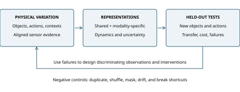

# From Synaesthetic Metaphor to Crossmodal Intelligence
## Evidence, Identifiability, and Lessons from Evolution

**AnimaFoundry | Critical integrative review | Version 1.0.0 | 16 October 2026**

**Preprint. Not peer reviewed.** Literature synthesis, exact algebraic illustrations, and a prospective research agenda; no new human, biological, hardware, or trained-model experiment is reported.

## Abstract

The rhetorical idea of describing one sensory domain through another motivates a useful question for sensor-rich artificial intelligence: can heterogeneous observations support transferable representations of a common physical process? This review separates synaesthetic metaphor, perceptual synaesthesia, crossmodal correspondence, multisensory integration, and functional machine learning. Human studies support bounded cue-integration and crossmodal-learning effects, while memory findings do not justify a universal learning advantage. Machine studies already demonstrate multimodal alignment, crossmodal prediction, sensory pretraining, and partial-information control. These results establish prior art rather than evidence of subjective machine experience. Their limitations motivate three distinctions: sensor count versus task-relevant information, shared embeddings versus identifiable physical mechanisms, and online fusion versus training-only crossmodal transfer. Exact least-squares examples show why repeated observations cannot repair missing excitation or collinearity, and why sparse observations can be informative without making disorder intrinsically useful. Mutation-rate experiments and digital evolution supply a further bounded analogy: variation can enable adaptation, but its value depends on selection, population structure, environment, and deleterious costs. Predator-prey dynamics provide no universal two-to-one population ratio. We propose a controlled contact-response study with independent physical excitation, strong system-identification and learning baselines, strict information boundaries, and prespecified negative controls. The defensible research hypothesis is that aligned, discriminating, and appropriately varied observations can improve particular transferable capabilities under resource constraints; neither arbitrary data accumulation nor biological analogy establishes this conclusion in advance.

**Keywords:** crossmodal learning; synaesthetic metaphor; multisensory integration; identifiability; sensor fusion; world models; mutation rate; eco-evolutionary dynamics.

## 1. Research question, scope, and prior overlap

Everyday language crosses sensory boundaries: a sound may be described as textured, a color as warm, or a taste as sharp. Such expressions suggest a research heuristic: different observations may constrain a common event, object property, or relation. However, a linguistic association can be useful without being a literal physical equivalence. A machine that associates a texture image with a sound has not thereby inferred the force that produced that sound, nor shown that it experiences either sensation.

The question examined here is conditional: **when does adding a sensory view, a source of physical variation, or a training context improve a capability that survives changes in objects, sensors, actions, and deployment inputs?** We focus on observable performance, uncertainty, and resource cost. We do not attempt to establish or exclude machine consciousness through behavioral benchmarks. The term functional crossmodal intelligence denotes an evaluation target in this article, not a new architecture or a clinical category.

Substantial prior work already addresses this space. Xiao and Stibor linked images and sounds through words under the title Toward Artificial Synesthesia in 2010 [@A01]. Cheng and colleagues developed Synesthesia of Machines for multimodal sensing-communication integration [@R01], followed by a foundation-model-oriented framework and case studies [@R02]. These wireless-system programs are not identical to a general physical world model, but they rule out claiming priority for the broad machine-synesthesia framing. Established multimodal surveys already distinguish representation, alignment, translation, fusion, co-learning, and evaluation challenges [@A06] [@A07]. Sensory-translation reviews and a recent boundary-preserving human framework likewise overlap the conceptual discussion [@H11] [@H12]. The contribution offered here is a critical connection between these literatures, identifiability, and a bounded experimental agenda; no exclusive gap or new invention is claimed.

This is a selective critical integrative review, **not a systematic review**, meta-analysis, or exhaustive account of current models. Targeted searches and source checks were conducted on 16 October 2026 in human perception and language, multimodal learning, embodied sensing, mathematical identification, and evolutionary biology. Primary papers support empirical claims; related reviews establish terminology and overlap. The public METHODS.md records representative executed queries, selection principles, and limitations. The bibliography ledger records reading depth for every source, including abstract-only access and failed full-text retrieval. No numerical results are pooled across incompatible tasks, and no source experiment was independently reproduced. The exact illustrations below verify only their stated arithmetic and assumptions. All proposed physical and learning experiments remain unperformed.

## 2. What the human analogy does and does not establish

### 2.1 Five concepts that should remain separate

**Table 1. Distinctions used throughout this review.** These are working distinctions, not a diagnostic instrument or an evolutionary ladder.

| Concept | Observable referent | Invalid inference |
| --- | --- | --- |
| Synaesthetic metaphor | Language transfers a descriptor between sensory domains | The speaker necessarily has perceptual synaesthesia |
| Perceptual/developmental synaesthesia | Particular inducers evoke additional experiences, often with characteristic consistency or automaticity | Every form has one mechanism or a general intelligence advantage |
| Crossmodal correspondence | Systematic compatibility between features across modalities | The mapping is universal, literal, or one-to-one |
| Multisensory integration | Multiple cues jointly affect a perceptual estimate or decision | All cues should always be fused |
| Functional crossmodal machine learning | Measurable alignment, prediction, transfer, or control involving distinct modalities | The system has human-like subjective sensations |

The Chinese rhetorical term tonggan motivates this work, but translating it as synaesthesia can obscure the distinction between a figure of speech and an unusual perceptual experience. A Mandarin corpus study found several directional patterns rather than a single universal sensory-transfer hierarchy [@H01]. A 2026 study related ratings of sensory metaphors to imagined crossmodal correspondences, with conventionality and emotional dimensions affecting the association. Its two groups of 90 participants evaluated language prompts; the experiment did not present physical tastants, tones, and visual stimuli as a multisensory training intervention [@H02]. This is evidence about associations in language-mediated judgments, not a demonstration that rhetoric produces a general sensory-learning mechanism.

Definitions of synaesthesia themselves require care: conceptual or linguistic inducers complicate a simple two-sense formula [@H03]. Research batteries operationalize selected features such as consistency and speeded congruency for particular forms [@H04]. A personal account of vivid cross-sensory associations can inspire a hypothesis, but cannot by itself identify its neurological mechanism or explain a person's learning ability. This review makes no individual diagnostic inference.

### 2.2 Useful human evidence is task-specific

Crossmodal correspondences can constrain how sensory attributes are associated, alongside temporal, spatial, and semantic relations [@H05]. In a visual-haptic height-estimation task, Ernst and Banks found behavior consistent with reliability-weighted cue combination [@H06]. This provides a bounded example of useful integration, not a rule that every added input helps. Common-source inference models further explain why discrepant audiovisual cues may be combined differently from cues attributed to separate causes [@H07]. Here, causal inference means inferring whether perceptual cues share an origin; it should not be confused with identifying intervention effects in a physical dynamical system.

Seitz and colleagues reported faster visual-motion learning after audiovisual training than after visual-only training with matched visual exposure; silent tests supported learning beyond concurrent access to sound. The final between-group difference for the trained direction was not significant after both groups approached asymptote [@H08]. This motivates separating learning speed, final performance, and training-only auxiliary information from extra deployment inputs in AI experiments. It does not establish a general intelligence effect, nor was the effect a test of developmental synaesthesia.

Memory findings also resist a universal slogan. Rothen and Meier's study of 13 grapheme-color synaesthetes and matched controls found no significant group advantage in the tested search and digit-matrix tasks [@H09]. A larger study by Lunke and Meier, covering 97 synaesthetes and matched controls, reported a small overall recognition-memory advantage with subtype-by-stimulus differences [@H10]. Neither a small null study nor heterogeneous positive results settle a universal benefit. These observational group comparisons do not randomize synaesthesia or establish that it causes broad learning superiority. For engineering, the transferable idea is to test whether an additional encoding relation improves a specified task, while preserving both positive and negative cases.

## 3. What machines have already demonstrated

### 3.1 Association, transfer, and shared representations

Ngiam and colleagues explicitly separated multimodal fusion from learning representations with multiple modalities and subsequently using fewer, as well as transferring a classifier across modalities in audiovisual speech settings [@A02]. CLIP established large-scale image-text learning with zero-shot visual classification transfer [@A03]. ImageBind linked image, text, audio, depth, thermal, and inertial observations through image-paired training, supporting crossmodal retrieval and recognition without training on every possible modality pair [@A04]. These are substantial functional achievements. They do not imply that arbitrary unpaired sensors will align or that a retrieved item is a calibrated reconstruction of a physical state.

Contrastive Multiview Coding explored representations that emphasize shared information and found benefits from additional views in its evaluated settings [@A05]. However, one common vector space need not mean identical geometry: modality-gap analysis showed that image and text embeddings can remain separated within a nominally shared space [@A09]. Nor is complete collapse into a common representation necessarily desirable. An acoustic transient may reveal an impact event also visible to a camera, while its frequency structure contains additional material information unavailable in the image.

Information decomposition formalizes distinctions between task-relevant redundant, unique, and synergistic information [@R03]. The target matters: two channels may be redundant for identifying an object and complementary for predicting its response to force. Available estimators approximate these quantities and introduce their own modeling and optimization errors; a reported synergy score is not proof of a physical mechanism. Factorized Contrastive Learning explicitly treats shared and modality-unique information [@A10]. CoMM instead aligns augmented joint multimodal representations and studies preservation of different information types under stated assumptions [@A11]. Their results motivate architectural comparisons, not a universal requirement to use either method.

### 3.2 Embodied predictions are stronger, but remain bounded

**Table 2. Representative machine capabilities and the next inference they do not establish.** Results belong to their original datasets, versions, apparatus, and evaluations.

| Evidence | Demonstrated or evaluated capability | Boundary |
| --- | --- | --- |
| Ngiam et al.; ImageBind | Crossmodal features or bridge-based alignment | Not arbitrary sensor correspondence or physical identification |
| VisGel | Vision-touch prediction, including unseen-object evaluation | A plausible tactile image need not be calibrated mechanics |
| Making Sense of Vision and Touch | Action-conditioned representation learning for contact-rich control | A bounded task family, not general physical competence |
| See, Hear, and Feel | Vision, sound, and touch in manipulation | Utility depends on contact configuration and apparatus |
| Crossmodal tactile pretraining | Auxiliary visual supervision for tactile features | Simulation evidence is not physical field validation |
| Partial-information iCub models | Missing-modality reconstruction, prediction, and imitation | Restricted sensor representation and perspective assumptions |

VisGel connected visual and tactile observations through crossmodal prediction [@E01]. Lee and colleagues combined vision, force/torque, proprioception, and action-related self-supervision for peg-insertion tasks [@E02]. See, Hear, and Feel examined visual, acoustic, and tactile inputs in manipulation; audio was useful in some ambiguous conditions and redundant in others [@E03]. In simulated tactile learning, crossmodal supervision improved particular representations, illustrating the distinction between training and deployment modalities [@E04]. These examples support studying functional transfer while retaining the specific task and embodiment boundaries.

Zambelli, Cully, and Demiris used multimodal representations for missing sensory information, prediction, and iCub trajectory imitation, with constraints including tracked hand coordinates and an egocentric perspective [@E06]. Owens and colleagues predicted impact sounds from silent video and tested plausibility and material information [@E08]. Perceptual realism is a different target from a calibrated predictive distribution of future mechanical response; the historical sound protocol also used test-video statistics in a normalization step, so it should not be described as an untouched-test calibration design. Modern tactile-only pretraining, exemplified by Sparsh, supplies a relevant strong comparator rather than proof of a multimodal advantage [@E05].

### 3.3 Failure evidence is part of the argument

Naive multimodal classification can underperform a strong single modality because modality learning dynamics and overfitting differ [@A08]. In imitation learning, additional observational features can also encourage causal confusion and reduce closed-loop performance under distribution shift [@E07]. This directly contradicts an unconditional rule that additional inputs always improve useful behavior. More sensors can create more opportunities to recognize the acquisition session rather than the physical property of interest.

Evaluation should therefore cover generalization, missing or noisy modalities, and computational cost, as established benchmark work such as MultiBench already emphasizes [@A12]. Winoground exposed compositional failures in the vision-language models evaluated in 2022 [@A13], but subsequent analysis showed that its difficulty also includes visual detail, commonsense, and fusion demands [@A14]. Historic failures should not be assigned to every current model, and a failed benchmark score should not be interpreted as a uniquely diagnosed cognitive deficit. The same discipline is needed for any proposed machine-synaesthesia test.

## 4. From data quantity to identifiable variation

### 4.1 The least-squares intuition, stated precisely

AnimaFoundry proposed that a channel receiving no informative variation cannot be learned merely by accumulating more data. Linear least squares gives a precise version. With a fixed observed design X containing n rows and p columns, parameter vector theta, and response y, define:

```
L(theta) = (1/2) ||X theta - y||^2
gradient L = X^T (X theta - y)
Hessian L = X^T X
```

The unconstrained least-squares coefficient vector is unique exactly when X has full column rank. A zero column makes its coefficient absent from the prediction, while linearly dependent nonzero columns leave combinations of coefficients indistinguishable. These are standard linear-algebra conditions [@R04]. By contrast, a zero loss gradient at a fitted solution does not diagnose missing information: it is also expected at a full-rank optimum. Regularization can select one coefficient vector without turning an unobserved direction into evidence.

The following examples are independently constructed illustrations. All use y = X theta with theta = (2, 3), no intercept, exact rational arithmetic, and no measurement noise. They compare rank, not accuracy per joule or an energy-matched experimental design. The complete rows are available in identifiability_example.json and the newly written calculation script.

**Table 3. Exact illustrative designs.** Rows with opposite signs are distinct observations; repeating a design does not add directions to its column rank.

| Design | Rows and construction | Rank; determinant of X^T X | Interpretation |
| --- | --- | --- | --- |
| Silent second channel | Four rows alternating (1,0), (-1,0) | 1; 0 | (2,3) and (2,99) predict identically |
| Collinear channels | Four rows alternating (1,1), (-1,-1) | 1; 0 | Only the coefficient sum is learned; (5,0) fits too |
| Repeated collinearity | Previous four-row design repeated 100 times | 1; 0 | 400 rows preserve the ambiguity |
| Crossed variation | (1,1), (1,-1), (-1,1), (-1,-1) | 2; 16 | Both coefficients are identifiable in this model |
| Sparse but spanning | (1,0), (-1,0), (0,1), (0,-1) | 2; 4 | Zeros need not prevent identification |
| Nearly collinear | (1,1), (1,1.01), (-1,-1), (-1,-1.01) | 2; 0.0004 | Full rank can coexist with poor conditioning |

For collinear rows, the null direction (1,-1) changes the coefficients without changing predictions. Repetition multiplies X^T X but preserves that null direction. It can improve precision in observable directions when fresh independent response noise is present; it cannot identify the missing coefficient combination. For the crossed design, X^T X = 4I, and the exact-fit gradient is zero even though the parameter vector is unique. Adding noise to y cannot change rank(X). Measurement error in X is a different problem: numerical full rank created by sensor noise is not automatically information about the intended physical mechanism.

The sparse example has fewer nonzero entries than the crossed example, yet spans both directions. Its zeros are observed values, not missing readings; it does not validate missing-data recovery or irregular sparse sampling. It shows that sparsity alone is neither a defect nor a virtue. Its smaller determinant also reflects different input scaling and total excitation, so the determinants must not be treated as a fair physical-performance ranking. Near-collinearity similarly requires attention to singular values, measurement scale, and noise rather than a binary rank certificate alone. These elementary examples verify a logical distinction; they are not evidence that a neural model will acquire a new capability.

### 4.2 Nonlinear learning needs more than a rank analogy

For a nonlinear predictor, local sensitivity of outputs to parameters can reveal directions that the collected observations fail to constrain. Yet neural parameter symmetries can make weights non-identifiable while useful predictions remain well determined. Recovering particular latent physical factors is stronger than predicting accurately on the observed distribution, and neither follows automatically from a nonsingular local diagnostic. Model misspecification, hidden state, insufficient action coverage, and measurement noise remain separate problems.

Unsupervised disentanglement is not generally identifiable without assumptions on models and data [@R05]. Nonlinear ICA with auxiliary variables supplies a positive counterpart: conditional structure, smoothness, invertibility, and sufficiently varied effects of the auxiliary variable can support identification up to stated transformations [@R06]. These are substantive assumptions, not a theorem that heterogeneous internet data suffice. In control, persistency-of-excitation results connect informative inputs to finite trajectory coverage for controllable linear time-invariant systems [@E09]. They should not be transferred without qualification to arbitrary nonlinear world models.

Thus, more diverse data should mean variation that distinguishes competing explanations under a stated model and task. More dimensions can expose an unobserved property, duplicate an existing property, or add a nuisance. Sparse sampling can save energy when it preserves relevant events, or erase the transition required for learning. Disorder can broaden coverage, or simply corrupt timestamps and units. Meaningful exploration retains provenance, synchronization uncertainty, and the intervention that produced an observation. Useful diversity is not synonymous with unstructured collection.

## 5. A functional contract for sensor-rich world models

We distinguish three claims. **Online fusion** asks whether extra sensors available during deployment improve a decision. **Training-only crossmodal transfer** asks whether auxiliary training observations improve a model that has the same limited deployment inputs as its baseline. **Physical predictive transfer** asks whether the learned relation remains useful across new physical instances, contexts, and interventions. These claims can succeed or fail independently; none is a test for subjective experience.



**Figure 1. Original analytical schematic.** Observations constrain a representation only through the collection process and learning objective. Held-out failures can guide a subsequent experiment, but a test set used to redesign the system becomes development evidence and cannot be reused as an untouched confirmation set.

Consider a model receiving sensor history h and a planned action sequence a, predicting a distribution over a future physical response q. A useful contract specifies the timestamps included in h, the action information available when the prediction is made, the units of q, and the calibration procedure. A plausible generated sound or image may be a secondary output, but cannot replace an error or calibration score on q. If several physical states explain the same observations, a distribution or abstention may be appropriate. Missing-sensor reconstruction must not be mislabeled as a new measurement.

Shared representations can encode common causes while modality-specific paths retain information that is not recoverable elsewhere. Whether to retain both is an empirical architectural question. The training objective should match the intended capability: retrieval rewards correspondence; prediction rewards future information; control additionally tests the effects of actions. Observational action logs from an existing controller may reflect its response to hidden state. Merely including those logs does not identify what would happen under a different action.

For distributed low-power sensing, these distinctions alter infrastructure choices. A node need not run the full multimodal model: it may report a calibrated event, uncertainty estimate, or compressed local history. The receiver must know sensor type, units, time base, missingness, and model compatibility. Compression is justified by retained task utility, not only by fewer bytes. Additional modalities also add calibration, communication, maintenance, and privacy costs. This article proposes no universal sensor-count or training-time scaling law, and no automatic inference that technical distribution decentralizes institutional power.

## 6. A prospective discriminating experiment

### 6.1 A bounded contact-response task

The most informative first study is a controlled physical comparison, not a general-purpose simulation advertised as validation. Use independently manufactured cantilever specimens from several material families, with adjustable clamp length and a motorized probe applying bounded displacement pulses. Record RGB, contact audio, probe encoder position, and force. A separate calibrated laser measures tip displacement as a **target-only** channel. It never enters encoder pretraining or input features. Hardware feasibility, alignment precision, and measurement floor must first be established on development specimens; they are not assumed measured here.

From a strictly past observation prefix and an explicitly planned future probe action, predict displacement over a fixed future horizon. No future measured force, sound, video, or executed-motion correction may enter the predictor. Causal filtering and cropped feature windows must prevent spectrograms or smoothing kernels from reaching into the target interval. Every comparator entitled to future planned actions receives the same plan. A pilot sets units, positive normalization scale, safe action bounds, sample size, and application-relevant thresholds before confirmation data are opened.

Independently vary probe amplitude, duration, location, and clamp length within those bounds. Avoid tying a factor deterministically to material, background, sensor identity, or acquisition day. Compare equal-interaction-duration collections with narrow repeated actions versus diverse independently varied actions. A linear rank or conditioning diagnostic can reveal deficient local excitation but does not certify nonlinear identification. If a relevant degree of freedom is below the measurement floor, additional identical frames cannot be described as solving that limitation.

### 6.2 Separate the value of sensors from the value of a learning method

Track A compares online fusion against the strongest sensor subsets, estimating the value of added deployment hardware. Track B gives every deployed predictor the same RGB and encoder history plus planned action; designated crossmodal learners may use audio and force during training only. Target-only laser labels are provided equally for supervised training across arms and remain excluded from representation pretraining. Extra auxiliary observations in Track B are the treatment, not an input-matched architecture comparison.

Include a calibrated physical state-space model where mechanically appropriate, regularized linear input-history regression, a recurrent predictor, and ordinary early/late fusion. All baseline features and initial-state estimates use only the observations permitted in their arm; none receives laser-target history or an oracle physical state. Compare a shared-only bottleneck against shared-plus-private representations using the same available channels. Use identical episodes, target labels, compute ceilings, tuning trials, and stopping rules for an architecture comparison. Separately compare sensor allocations under fixed telemetry and under equal interaction time. More channels at unchanged sampling rate do not constitute an equal-data-budget comparison. Record actual cost rather than equating parameter count with training compute or sensing energy.

**Table 4. Required negative controls and their interpretation.** Controls diagnose mechanisms; no single control replaces the primary held-out physical prediction test.

| Control | What it probes | Limitation |
| --- | --- | --- |
| Duplicate an existing channel | Extra dimensions or model capacity alone | Duplicates can still change optimization |
| Matched-volume independent noise | Benefit from nuisance inputs | One noise distribution is not every deployment fault |
| Wrong-event pairing within nuisance strata | Event-specific correspondence versus category/session cues | Shuffling changes joint distributions intentionally |
| Past-only time shifts beyond the correspondence window | Dependence on temporal alignment | Loss of timing does not uniquely identify causality |
| Missing modalities and calibration drift | Robustness and uncertainty | Dropout mechanisms must be declared |
| Reverse a nonphysical training correlation | Shortcut dependence | Artificial shortcuts do not exhaust real ones |
| Narrow versus independently varied actions | Value of excitation coverage | A deficient model may still fail with good coverage |
| Remove action information | Dependence on the intended action contract | A diagnostic arm, not a fair substitute for all other arms |

Hold out entire physical specimens, acquisition sessions, and a material family. Report unseen-specimen interpolation separately from material-family extrapolation. Adjacent frames are not independent experimental units. Calibration, normalization, and tuning use development data only. Estimate uncertainty over physical units and acquisition blocks; a small number of independently held-out units can render the outcome inconclusive even with many frames.

Define improvement as baseline error minus candidate error on the primary physical target. Select the strongest baseline on development validation data, or predeclare a confirmatory comparison family with multiplicity control; do not select a favorable comparator after viewing test results. Before confirmation, choose a minimum useful improvement delta from measurement repeatability and decision cost, and a maximum tolerated degradation epsilon under specified faults. A positive result requires an appropriately clustered uncertainty interval above delta and the prespecified robustness condition, with no unresolved leakage or budget violation. An interval entirely below delta supports stopping the proposed superiority claim in this setting; one spanning delta is inconclusive. Statistical nonsignificance is not equivalence. All comparisons, multiplicity handling, seeds, and stopping rules must be fixed before testing. If ordinary identification or fusion already satisfies the task, that is a valid stopping outcome.

No listed experiment is claimed to have been performed. A successful study would establish bounded functional value, not machine synaesthesia, a universal world model, or a cleared invention. Failure evidence remains part of the result rather than an invitation to relabel the same evaluation data as a fresh test.

## 7. Biological variation, adaptation, and ecological feedback

### 7.1 Mutation probability is not a general adaptability score

Evolutionary biology offers relevant evidence about variation and adaptation, but its variables differ from those in gradient-based learning. A mutation rate requires a unit: per site or genome, and per replication or generation. Mutation supply also depends on how many reproduction events occur. Current fitness concerns reproductive performance in a specified environment; adaptation rate concerns change in that performance; evolvability concerns the production of selectable heritable variation under specified conditions. None is interchangeable with a generic species adaptability score, and within-lifetime learning need not be inherited population change.

In experimental asexual populations, de Visser and colleagues found that returns to mutation supply depended on population size and initial adaptation, with diminishing returns outside particular conditions [@B01]. This is evidence against simple proportionality, not by itself a diagnosis of harmful-mutation costs. Sprouffske and colleagues studied E. coli populations with four mutation-rate backgrounds over 3,000 generations. Greater diversity did not monotonically improve adaptation, and some highest-rate populations adapted less well [@B02]. The latter study more directly examines the balance between adaptive opportunity and deleterious effects. Neither study prescribes one optimum for every organism, environment, or evaluation horizon.

Wielgoss and colleagues traced a laboratory population in which a hypermutable lineage was later invaded by lineages with reduced mutation rates, consistent with a changing balance between adaptive opportunity and genetic load [@B03]. This is evidence about the studied population and its history, not foresighted optimization for future species success. Selection acts through realized reproductive differences; it need not maximize a researcher's chosen long-term objective.

### 7.2 Simulated evolution supplies tests, not biological guarantees

Digital evolution is an established way to isolate such questions. Clune and colleagues used Avida to show that self-evolved mutation rates on rugged fitness landscapes could remain below rates that maximized long-term adaptation in their experiments [@B04]. A more recent Avida study found that environmental change influenced both mutation rates and genotype-to-phenotype neighborhoods, with different contributions to adaptation to recurring and novel environments [@B05]. These are implemented experimental systems, not metaphors alone, but their numerical settings and reward structures are part of the result. They do not establish an optimal sensor dropout rate, neural learning rate, or probability of parameter mutation for unrelated AI systems.

**Table 5. A limited analogy between evolutionary and machine adaptation.** Each proposed transfer requires a new experiment.

| Biological or digital-evolution quantity | Possible machine-learning counterpart | Essential distinction |
| --- | --- | --- |
| Heritable mutation | Explicit perturbation of inherited candidate programs or weights | Additional observations do not themselves mutate a genome |
| Mutation supply | Number and distribution of evaluated candidate changes | Raw sensor samples are observations, not candidate descendants |
| Fitness and selection | A declared objective and selection rule | Training reward need not match deployment utility |
| Environmental change | Prespecified task or distribution shift | Arbitrary corruption may destroy information instead of adding a task |
| Genetic load | Costs of harmful candidate changes | Sensor noise and model damage have different mechanisms |
| Evolvability | Measured adaptation after held-out shifts | Immediate accuracy or diversity alone is insufficient |

The useful connection is the need to specify which variation is generated, which structure is retained, and which outcomes determine success. Input diversity, data augmentation, gradient updates, and evolutionary parameter search are four different interventions. Combining them without factorial controls would make an observed gain difficult to interpret. An optional later digital study could compare fixed and adaptive mutation schedules under equal total evaluation budgets, crossed with smooth/rugged objectives and recurring/novel shifts. It should measure immediate score, recovery after shifts, long-horizon performance, and diversity separately, with a non-evolutionary optimizer where meaningful. That study is proposed, not executed here. Its outcome would not validate the physical sensor proposal without a separate physical comparison.

### 7.3 Predator-prey balance has no universal two-to-one constant

Classical population dynamics, including Volterra's work, provides a distinct historical framework for interacting populations [@B06]. To make the ratio question explicit, consider the following idealized continuous-time model, stated in modern notation. N is prey abundance, P predator abundance, and a, b, c, d are positive coefficients with consistent units:

```
dN/dt = a N - b N P
dP/dt = c N P - d P
N* = d/c,  P* = a/b
N*/P* = (b d)/(a c)
```

The positive equilibrium ratio therefore depends on parameters. Choosing a=b=c=1 and d=2 yields 2:1; choosing all four as 1 yields 1:1. Both are mathematical examples, not calibrated ecosystems. The unmodified model has neutral closed orbits around its positive equilibrium rather than generic convergence back to a preferred ratio. Instantaneous ratios along an orbit vary. An ecological time series, its time average, a coexistence equilibrium, individual counts, biomass, and body-size ratios are different quantities. A fixed-parameter predator-prey model also contains no heritable mutation and is not, by itself, a simulation of evolutionary adaptation.

Empirical ecological patterns do not rescue a universal 2:1 claim. Hatton and colleagues analyzed 2,260 communities and reported predator-prey biomass scaling with exponents near three quarters [@B07]. A power-law exponent relating biomass across communities is neither an individual-number ratio nor a universal dynamical equilibrium. The particular simulation remembered as showing 2:1 was not identified in this review; its result cannot be accepted or rejected as a statement about that unknown implementation. The broader fixed-ratio claim is unsupported by the sources and model examined here.

Eco-evolutionary research is a closer bridge to adaptation: Yoshida and colleagues combined algal-rotifer experiments with models and manipulated prey clonal diversity, finding changes in population-cycle behavior [@B08]. This involves heritable variation affecting ecological interaction rather than merely changing abundance. It suggests testing feedback between an adaptive learner and the data it subsequently encounters. It does not supply a universal ratio between exploration and exploitation, training modalities, or learning agents.

### 7.4 What can legitimately be carried across domains?

The least-squares argument and evolutionary evidence address different obstacles. Uninformative observations can leave a physical distinction unresolved even with unlimited repetitions. A search process may generate too few useful candidate changes, or too many harmful ones, even when observations are informative. An ecosystem may oscillate because populations alter each other's growth conditions, without any learning algorithm. A combined AI study should measure these mechanisms separately: informative coverage, optimization/search behavior, and feedback-induced distribution shift. The biological analogy strengthens the question about conditional variation; it does not turn more disorder into a law of progress.

## 8. Conclusions and evidential limits

The literature supports functional crossmodal association, bounded transfer, sensory prediction, and selected control benefits. It also documents failure, unequal modality utility, and dependence on data-generation and evaluation choices. Human sensory rhetoric supplies a productive question but no direct proof of an AI mechanism. Human synaesthesia is heterogeneous, and its relation to particular memory tasks cannot establish a general learning law or diagnose an individual.

Our synthesis favors discriminating observations over indiscriminate accumulation. An extra sensor is useful when it supplies information relevant to a specified target or makes training transfer more efficient under declared conditions. Extra dimensions can be redundant; shared embeddings can omit private information; sparse observations can either span the relevant variations or miss them. Biological and digital evolution further caution that variation has costs and that short-term selection need not optimize long-term adaptation. No unique numerical balance follows from these analogies.

This review's selectivity, uneven reading depth, publication and accessibility biases, and reliance on reported studies limit its conclusions. It does not rank every available model, establish an exclusive research gap, identify a universal causal representation, or supply a sensor scaling law. The proposed contact-response study remains a design requiring pilot work and prospective registration. Exact algebra, reproducible document builds, and internal checks improve auditability but cannot substitute for experimental replication, independent peer review, or demonstrated deployment value.

## 9. Research vision proposed by AnimaFoundry

AnimaFoundry's motivating vision is that diverse observations embedded in everyday objects could allow machine systems to connect sensory domains and learn physical relations that remain inaccessible to narrower inputs. The analogy to tonggan emphasizes the ability to use one mode of description or observation to illuminate another. The accompanying least-squares intuition emphasizes that repeated data cannot reveal a direction that the observation process never distinguishes. A further evolutionary analogy asks how variation, retention, and selection interact when environments change.

In a testable formulation, the vision predicts that appropriately aligned, physically discriminating observations and independently varied interactions can improve selected crossmodal prediction and transfer tasks beyond strong existing methods, while respecting resource limits. It further predicts that some benefits can survive removal of auxiliary training modalities at deployment. Both predictions may fail. They require comparison with simpler explanations, including ordinary sensor fusion, better action coverage, additional supervision, or greater compute.

The vision is therefore an attributed research proposal, not evidence that more sensors inevitably produce intelligence, that randomness is inherently beneficial, that AI has human synaesthetic experience, or that a particular person's learning mechanism has been established. Its most valuable next step is a small, well-controlled demonstration of transferable information under explicit failure conditions. Only after such evidence should the program expand toward broader distributed sensing, adaptive learning, and selective return of validated capabilities to endpoints.

## Declarations

**Authorship and assistance.** AnimaFoundry supplied the motivating concepts and subsequent identifiability and biological questions. Literature searches, synthesis, original prose, analytical examples, document tooling, and internal checks were produced with OpenAI Codex assistance. Internal AI-agent checks are not independent human peer review. No institutional affiliation, external endorsement, funding award, or journal acceptance is claimed.

**Data and reproducibility.** The release contains original text, an original schematic, bibliographic evidence records, and newly constructed exact algebraic examples. No human-subject dataset, biological experiment, sensor trace, trained model, or physical validation is supplied. Build verification checks artifact consistency, not the truth of every literature claim. The review is recorded separately from software-product and invention deliveries.

**Rights.** Original prose and the schematic are offered under CC BY 4.0; helper code under MIT. The PDF builder is adapted from AnimaFoundry's earlier IoI review tooling with attribution. Referenced works retain their rights. No third-party article, figure, dataset, model weight, or private attachment is redistributed. Citation and open-source licensing do not establish third-party patent permission; no novelty or freedom-to-operate determination is made. Future implementations require assessment of their actual features and sources.
